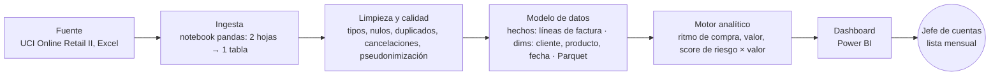

# Project Brief — Online Retail II

**Autor:** Lucas Vicente Marinello De Giacomi · **Unit 17 – Data Science for Business Support** · MSMK University

## 1. Dataset

### Dataset card

| Campo | Respuesta |
|---|---|
| Nombre | Online Retail II |
| Publicador y URL | UCI Machine Learning Repository — https://archive.ics.uci.edu/dataset/502/online+retail+ii (Chen, D., 2012, DOI 10.24432/C5CG6D) |
| Licencia (nombre exacto y enlace) | Creative Commons Attribution 4.0 International (CC BY 4.0) — https://creativecommons.org/licenses/by/4.0/ |
| Fecha de descarga y versión o última actualización | Descargado el 13/11/2026 · publicado en UCI el 20/09/2019 · dataset estático (sin actualizaciones) |
| Grano: ¿qué es una fila? | Una línea de producto dentro de una factura (factura × producto) |
| Periodo cubierto | 01/12/2009 – 09/12/2011 (≈ 24 meses) |
| Tamaño: filas × columnas, MB | 1.067.371 filas × 8 columnas · 45,6 MB (.xlsx, dos hojas: Year 2009-2010 y Year 2010-2011) |
| Columnas clave: fechas, dimensiones, medidas, target candidato | **Fecha:** InvoiceDate · **Dimensiones:** Country (43 países), StockCode/Description (5.305 productos), Customer ID (5.942 clientes), tipo de factura (venta / cancelación) · **Medidas:** Quantity, Price (£), Revenue = Quantity × Price (derivada) · **Target candidato:** churn del cliente (no compra en los 90 días siguientes), derivado de Customer ID + InvoiceDate |
| Problemas de calidad detectados | 243.007 filas (22,8 %) sin Customer ID · 4.382 (0,4 %) sin Description · 34.335 (3,2 %) filas duplicadas exactas · 19.494 (1,8 %) líneas de cancelación (Invoice empieza por "C") · 22.950 (2,2 %) filas con Quantity ≤ 0, de las cuales ~3.456 no son cancelaciones · 6.207 (0,6 %) filas con Price ≤ 0 · Customer ID almacenado como decimal (float) · el 91,9 % de las filas son del Reino Unido |
| Otras fuentes que se unirán | Ninguna en esta fase. El dataset cubre por sí solo los criterios del proyecto; se valorará añadir un calendario de festivos del Reino Unido si el análisis de estacionalidad lo requiere. |

## 2. Problema de negocio

### 2.1 Organización, departamento y stakeholder

**Organización.** Tienda online del Reino Unido, sin tiendas físicas, que vende artículos de regalo. Muchos de sus clientes son mayoristas (tiendas y revendedores) que compran en grandes cantidades de forma recurrente. Entre 2009 y 2011 vendió a 5.942 clientes identificados de 43 países.

**Departamento.** El equipo de cuentas mayoristas: 4 gestores que mantienen la relación con estos clientes para que sigan haciendo pedidos.

**Stakeholder.** El jefe de cuentas mayoristas. A principio de cada mes revisa el dashboard, decide a qué clientes contactar y reparte los contactos entre los gestores. Lo que puede cambiar es a quién se ofrece un descuento en el próximo pedido.

*El tamaño del equipo y su forma de trabajar son supuestos: el dataset no incluye información interna.*

### 2.2 La decisión a apoyar

**Con esto, el jefe de cuentas decidirá cada mes a qué clientes con riesgo de dejar de comprar ofrecer un descuento, priorizando a los que más ingresos aportan.**

**Restricciones:**
- **Capacidad:** solo se pueden contactar unos 100–150 clientes al mes, así que hace falta una lista priorizada.
- **Coste:** un descuento a un cliente que iba a volver igual es margen perdido.
- **Datos:** el 22,8 % de las líneas no tiene Customer ID, y no hay datos de margen ni de contactos.
- **Legal:** GDPR (ver sección 4).

**Alternativas sin un sistema de datos:** (a) contactar a todos los clientes, que no cabe en la capacidad; (b) una regla simple ("más de 60 días sin comprar"), barata pero ciega al valor y al ritmo de cada cliente. Esta regla será la línea base que la propuesta debe mejorar.

### 2.3 Hipótesis

**Churn:** cliente que compró en los 12 meses anteriores a la fecha de corte (10/09/2011) y no vuelve a comprar en los 90 días siguientes. Solo se usan líneas con Customer ID.

**Prioridad:** H1 > H2 > H3. H1 decide si hace falta un modelo o basta una regla; H2, cómo se ordena la lista; H3 añade una señal al riesgo.

| | |
|---|---|
| **H1** | *Una regla fija de 60 días no sirve para todos, porque cada cliente tiene su propio ritmo de compra.* |
| Métrica | % de clientes (con ≥ 3 compras en los 12 meses previos) cuyo intervalo mediano entre facturas supera los 60 días. |
| Dirección esperada | Más del 30 %. |
| Cómo se testea | Histograma y boxplot del intervalo mediano por cliente (L04); comparar cuántos churners reales detecta la regla fija frente a una personalizada (días sin comprar > 1,5 × intervalo habitual). |
| Si es verdad → | Umbral personalizado por cliente; en el bloque 3, un modelo que lo aprenda. |
| Si es falsa → | Se mantiene la regla fija, más fácil de explicar. |

| | |
|---|---|
| **H2** | *Los ingresos están concentrados en pocos clientes.* |
| Métrica | % de los ingresos de los 12 meses previos (Quantity × Price, descontando cancelaciones) que genera el 20 % de clientes con más ingresos. |
| Dirección esperada | Más del 70 %. |
| Cómo se testea | Curva de Pareto: ingresos acumulados con los clientes ordenados de mayor a menor (L04). |
| Si es verdad → | La lista se ordena por riesgo × valor. |
| Si es falsa → | La lista se ordena solo por riesgo. |

| | |
|---|---|
| **H3** | *Los clientes que cancelaron algún pedido tienen más churn.* |
| Métrica | Tasa de churn de clientes con al menos una cancelación en los 12 meses previos frente a la de clientes sin cancelaciones. |
| Dirección esperada | Al menos 10 puntos porcentuales más. |
| Cómo se testea | Barras con la tasa de churn por grupo, repetidas dentro de grupos de frecuencia de compra para controlar el confusor (L04): quien más compra, más ocasiones tiene de cancelar. |
| Si es verdad → | Las cancelaciones pasan a ser una señal de alerta que adelanta el contacto. |
| Si es falsa → | Se tratan como un tema operativo y no se usan para priorizar. |

### 2.4 KPIs

| KPI | Definición y fórmula | Grano | Comparación | Objetivo | Hipótesis |
|---|---|---|---|---|---|
| **1. Tasa de churn** | `clientes en churn / clientes activos × 100` | Mensual | Segmento de valor · Reino Unido vs resto | −3 puntos frente a la línea base histórica | General |
| **2. Ingresos en riesgo (£)** | `Σ ingresos 12 meses de clientes en riesgo` | Mensual | Segmento de valor | Que la lista de 100–150 clientes cubra ≥ 60 % de los ingresos en riesgo | H2 |
| **3. Precisión de la lista** | `clientes de la lista que hicieron churn / clientes en la lista × 100` (datos históricos) | Por fecha de corte | Regla fija vs personalizada · con y sin cancelaciones | Regla personalizada > regla fija | H1, H3 |
| **4. Tasa de recuperación** | `contactados que compran en 90 días / contactados × 100` | Mensual | Gestor · segmento de valor | ≥ 30 % (supuesto, se revisa a los 3 meses) | Proceso |

Los objetivos son supuestos y se ajustarán al medir la línea base. El KPI 4 no se puede calcular con el dataset (no registra contactos); queda definido para cuando el equipo use el dashboard.

**Trade-offs:**
- **Precisión vs cobertura (3 vs 2):** una lista más amplia cubre más ingresos, pero incluye clientes que volverían igual y gasta capacidad y descuentos.
- **Churn vs ingresos (1 vs 2):** priorizar clientes grandes reduce los ingresos perdidos sin mover casi la tasa de churn. Por eso el KPI principal es el 2.

## 3. Diseño de la solución

### 3.1 Tipo de solución

**Motor analítico (principal) + dashboard de gestión.** Un dashboard solo diría cuántos clientes se pierden, no a quién llamar; una herramienta de simulación de descuentos necesitaría datos de margen que no existen. El motor produce una lista accionable con los datos disponibles.

- **Entradas:** líneas de factura con Customer ID.
- **Lógica:** por cliente, recencia, frecuencia, ritmo habitual (H1), valor (H2) y cancelaciones (H3) → score de riesgo (regla personalizada; en el bloque 3, un modelo de churn) → orden por riesgo × valor.
- **Salidas:** cada mes, la lista priorizada de 100–150 clientes con su riesgo, valor y motivo de alerta, junto con los KPIs.

### 3.2 Arquitectura general

| Capa | Qué hace | Herramienta | Refresco |
|---|---|---|---|
| Fuente | Transacciones 2009–2011 | Excel de UCI | Estático (en un caso real, exportación mensual) |
| Ingesta | Une las dos hojas y guarda en Parquet | pandas | Mensual |
| Limpieza y calidad | Tipos, cancelaciones, duplicados, precios ≤ 0, exclusión de líneas sin cliente, pseudonimización | pandas | Mensual |
| Modelo de datos | Hechos (líneas de factura) + dimensiones cliente, producto y fecha | Parquet | Mensual |
| Motor analítico | Métricas por cliente, score y lista priorizada | pandas (scikit-learn en el bloque 3) | Día 1 de cada mes |
| Dashboard | KPIs, filtros y lista de contactos | Power BI | Día 1 de cada mes |

**Responsables:** el analista de datos (yo) mantiene los notebooks y publica el dashboard; el jefe de cuentas lo consulta.

**Si la fuente cambia de formato:** la ingesta valida las 8 columnas y sus tipos (contrato de ingesta, L02). Si falla, se detiene y el dashboard conserva el mes anterior.

**Dónde vive:** código y brief en mi repositorio de GitHub (`project/`); datos en local, sin subirlos por su tamaño, descargables desde UCI.

## 4. Riesgos y limitaciones

- **Clientes sin identificar (22,8 %):** quedan fuera del churn, así que los ingresos en riesgo están subestimados.
- **Sesgo geográfico:** el 91,9 % de las filas son del Reino Unido; las conclusiones para otros países serán poco fiables.
- **Datos antiguos y estáticos (hasta 2011):** el proceso mensual se simula; en un caso real habría que conectarlo al sistema de ventas.
- **Sin margen ni contactos:** no se puede medir el coste de los descuentos ni el KPI 4.
- **Privacidad (GDPR):** el Customer ID, combinado con país e historial, podría identificar a un cliente. Se pseudonimiza con un hash con sal (L03) en todo lo publicado; la tabla de correspondencia solo la ve el equipo de cuentas, y el dashboard muestra solo lo necesario.
- **Ética:** priorizar a los clientes de más valor da peor trato a los pequeños; debe ser una decisión explícita y revisada.
